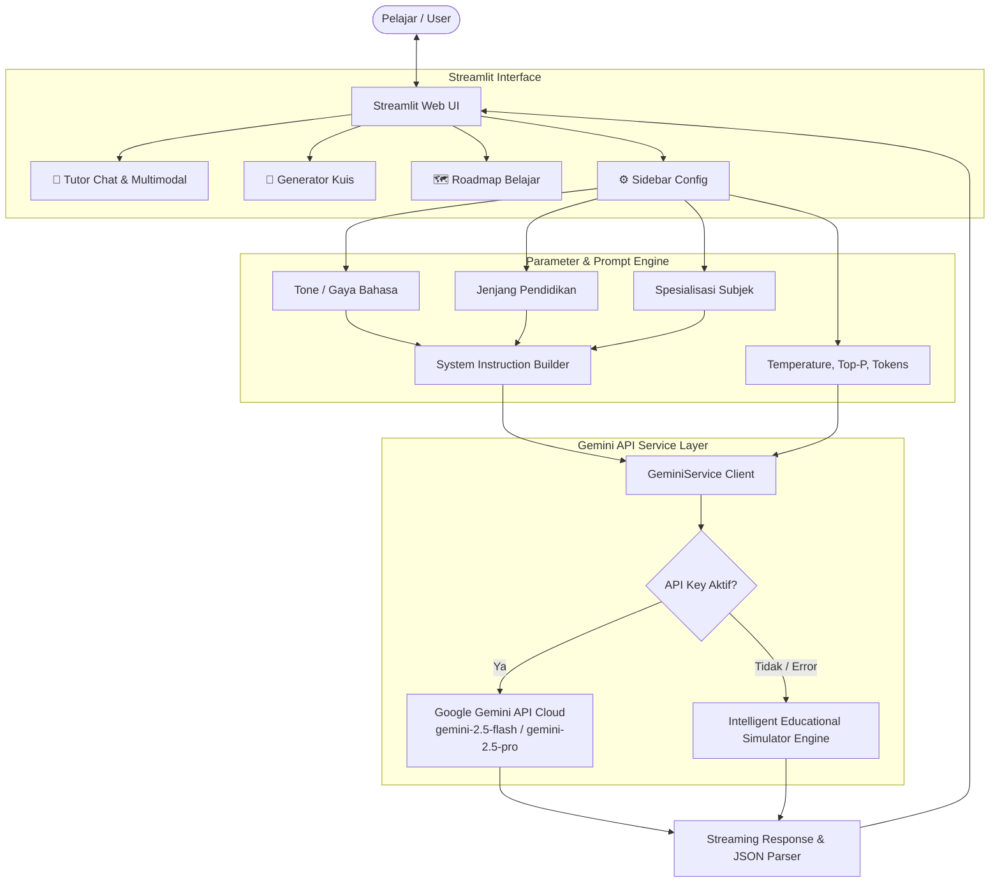

# 🎓 StudyBuddy AI - Asisten Belajar & Tutor Interaktif Cerdas
> **Final Project: AI Productivity and AI API Integration for Developers**  
> *Membangun chatbot berbasis Large Language Model (LLM) dengan use case edukasi dan konfigurasi parameter kreatif menggunakan Google Gemini API.*

[](https://www.python.org/)
[](https://streamlit.io/)
[](https://ai.google.dev/)
[](LICENSE)

---

## 📌 Ringkasan Proyek

**StudyBuddy AI** adalah chatbot asisten pendidikan interaktif yang dirancang untuk membantu siswa, mahasiswa, dan pembelajar mandiri dalam memahami materi pelajaran, memecahkan soal kompleks, menguji pemahaman lewat kuis interaktif, dan merancang kurikulum belajar terarah.

Aplikasi ini mengintegrasikan **Google Gemini LLM API** (`google-genai` & `google-generativeai`) dengan antarmuka web modern berbasis **Streamlit**, dilengkapi dengan sistem konfigurasi multi-parameter kreatif, chat memory multi-turn, dukungan pemformatan matematika LaTeX, rendering blok kode, input multimodal (gambar/foto soal), dan Pomodoro timer.

---

## 🌟 Fitur Utama

### 1. 💬 Tutor Interaktif & Diskusi Multi-Turn
- **Multi-turn Memory**: Bot mengingat konteks percakapan sebelumnya dalam satu sesi belajar.
- **Formula LaTeX & Syntax Highlighting**: Mendukung persamaan matematika kompleks (`$a^2 + b^2 = c^2$`) dan kode program dengan penyorotan sintaks rapi.
- **Multimodal (Vision)**: Pengguna dapat mengunggah foto diagram, soal lembar kerja, atau catatan buku untuk dianalisis dan dibahas oleh AI.
- **Quick Starters**: Tombol pemicu cepat untuk pertanyaan populer (Pythagoras, Clean Code, Fotosintesis, Machine Learning).

### 2. 🎭 Konfigurasi Parameter Kreatif
Bot menyediakan modulasi parameter dinamis di bilah samping (sidebar):
- **Gaya Bahasa / Tone Persona**:
  - 🎈 *Santai & Gaul (Peer Tutor)*: Bahasa santai, ramah layaknya teman sebaya atau kakak tingkat.
  - 🎓 *Formal & Akademis*: Standar baku ilmiah untuk kalangan mahasiswa dan akademisi.
  - 🤔 *Metode Socrates (Tutor Reflektif)*: Menuntun dengan pertanyaan reflektif agar pengguna menemukan konsep sendiri.
  - 👶 *ELI5 (Explain Like I'm 5)*: Penjelasan super sederhana dengan analogi nyata sehari-hari.
  - ⚡ *Ringkas & To-the-Point*: Bullet points, ringkasan inti, dan rumus cepat.
- **Jenjang Pendidikan Sasaran**:
  - SD / SMP (Dasar)
  - SMA / SMK (Menengah)
  - Kuliah / Universitas (Lanjutan)
  - Umum & Otodidak
- **Spesialisasi Subjek**:
  - 📐 Matematika & Logika (Fokus LaTeX & pembuktian)
  - 🔬 Sains (Fisika, Kimia, Biologi)
  - 💻 Pemrograman & Computer Science (Clean code & debugging)
  - 📚 Bahasa & Sastra
  - 📜 Sejarah & Humaniora
  - 🌐 Semua Bidang (All-Rounder)
- **Hyperparameter Model**:
  - `Temperature`: Mengontrol kreativitas vs determinisme (0.0 - 2.0).
  - `Top-P`: Mengatur keragaman pemilihan kata (*Nucleus Sampling*).
  - `Max Output Tokens`: Menyesuaikan panjang maksimal respon (256 - 4096).

### 3. 📝 Generator Kuis & Flashcards Otomatis
- Menghasilkan soal pilihan ganda dinamis berdasarkan topik dan tingkat kesulitan yang ditentukan.
- Evaluasi otomatis langsung di aplikasi lengkap dengan perolehan skor dan pembahasan komprehensif untuk setiap butir soal.

### 4. 🗺️ Kurator Roadmap Belajar Mandiri
- Menghasilkan rencana kurikulum 4 fase terstruktur (Fondasi, Konsep Inti, Proyek Nyata, dan Evaluasi Lanjut) untuk topik apa pun.
- Disertai rekomendasi buku, dokumentasi resmi, serta alokasi jam belajar per minggu.

### 5. ⏱️ Produktivitas & Ekspor Catatan
- **Pomodoro Timer**: Widget fokus 25 menit dan istirahat 5 menit terintegrasi di sidebar.
- **Ekspor Riwayat**: Unduh catatan sesi belajar ke format **Markdown (.md)** atau **Plain Text (.txt)**.
- **Mode Fleksibel**: Mendukung **Live Gemini API** serta **Intelligent Fallback/Demo Mode** jika API key belum diisi.

---

## 🏗️ Arsitektur Sistem



---

## 📁 Struktur Direktori

```text
studybuddy-bot/
├── app.py                      # Aplikasi utama Streamlit
├── requirements.txt            # Daftar pustaka & dependensi
├── .env.example                # Template konfigurasi API Key
├── .gitignore                  # Berkas pengabaian git
├── README.md                   # Dokumentasi lengkap proyek
├── modules/
│   ├── __init__.py
│   ├── gemini_client.py        # Klien Gemini API, streaming & fallback engine
│   ├── prompts.py              # Builder sistem instruksi & konfigurasi persona
│   └── utils.py                # Utilitas ekspor catatan (MD/TXT) & parser JSON
└── screenshots/                # Tangkapan layar antarmuka pengguna
```

---

## 🚀 Panduan Instalasi & Menjalankan

### 1. Prasyarat
- Python 3.10 atau versi lebih baru
- Google Gemini API Key (dapat diperoleh gratis di [Google AI Studio](https://aistudio.google.com/app/apikey))

### 2. Kloning Repositori
```bash
git clone https://github.com/JustNickyH/StudyBuddy-AI.git
cd StudyBuddy-AI
```

### 3. Setup Virtual Environment
```bash
# Membuat virtual environment
python3 -m venv env

# Mengaktifkan virtual environment
# Di Linux/macOS:
source env/bin/activate
# Di Windows:
# env\Scripts\activate
```

### 4. Instal Dependensi
```bash
pip install -r requirements.txt
```

### 5. Konfigurasi API Key (Opsional)
Salin berkas `.env.example` menjadi `.env`:
```bash
cp .env.example .env
```
Buka file `.env` dan masukkan API Key Anda:
```env
GEMINI_API_KEY=AIzaSy...
```
*(Catatan: Anda juga dapat memasukkan API Key langsung melalui kolom input di sidebar aplikasi).*

### 6. Jalankan Aplikasi
```bash
streamlit run app.py
```
Buka browser pada alamat: **`http://localhost:8501`**

---

## 📊 Matriks Parameter Kreatif

| Parameter | Pilihan Nilai | Efek pada Output AI |
|---|---|---|
| **Gaya Bahasa (Tone)** | Santai (Peer), Formal Akademis, Socrates, ELI5, To-The-Point | Mengubah perbendaharaan kata, gaya komunikasi, dan pendekatan pedagogis bot |
| **Jenjang Pendidikan** | SD/SMP, SMA/SMK, Kuliah/Universitas, Umum | Mengatur kedalaman materi, kompleksitas abstraksi, dan referensi teori |
| **Spesialisasi Subjek** | Matematika, Sains, Coding, Bahasa, Sejarah, All-Rounder | Mengaktifkan format khusus (LaTeX math, clean code, grammar rules, timeline) |
| **Temperature** | 0.0 - 2.0 (Default: 0.7) | Mengatur variasi kreativitas vs ketepatan jawaban |
| **Top-P** | 0.1 - 1.0 (Default: 0.95) | Mengontrol batas kumulatif distribusi token probabilitas |
| **Max Tokens** | 256 - 4096 (Default: 2048) | Membatasi panjang maksimal jawaban dari model |

---

## 📷 Tangkapan Layar Antarmuka Pengguna (UI Screenshots)

Antarmuka aplikasi dapat dilihat di folder [`screenshots/`](screenshots/):
1. **Chat & Tutor Interaktif**: Menampilkan percakapan tanya jawab materi dengan rumus LaTeX dan sidebar parameter.
2. **Generator Kuis & Penilaian**: Menampilkan latihan soal interaktif, radio button jawaban, dan hasil skor langsung.
3. **Roadmap Belajar**: Menampilkan kurikulum pembelajaran bertahap dan tombol unduh catatan belajar.

---

## 🔗 Deliverables Proyek

- **URL Repositori GitHub**: [https://github.com/JustNickyH/StudyBuddy-AI](https://github.com/JustNickyH/StudyBuddy-AI)
- **Teknologi Model**: Google Gemini API (`gemini-2.5-flash`, `gemini-2.5-pro`, `gemini-1.5-flash`)
- **Pengembang**: JustNickyH

---
*Dikembangkan untuk Final Project: AI Productivity and AI API Integration for Developers.*
